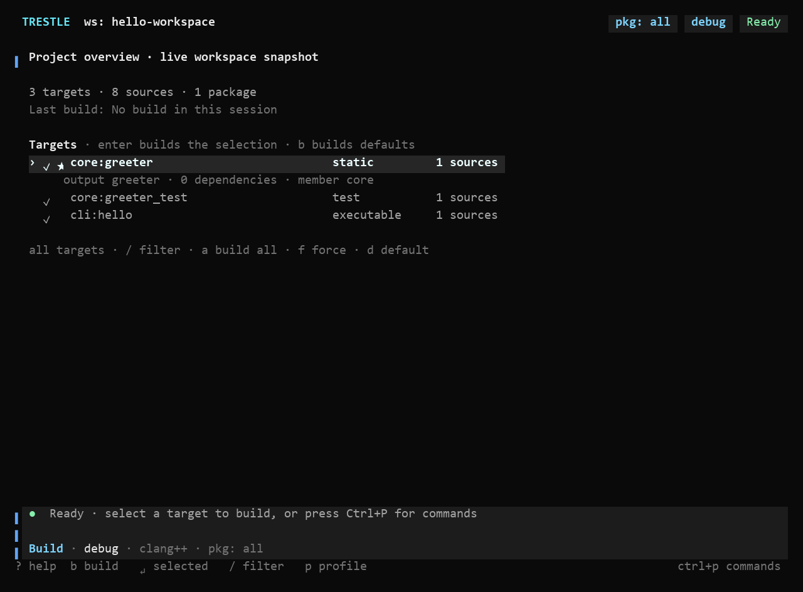
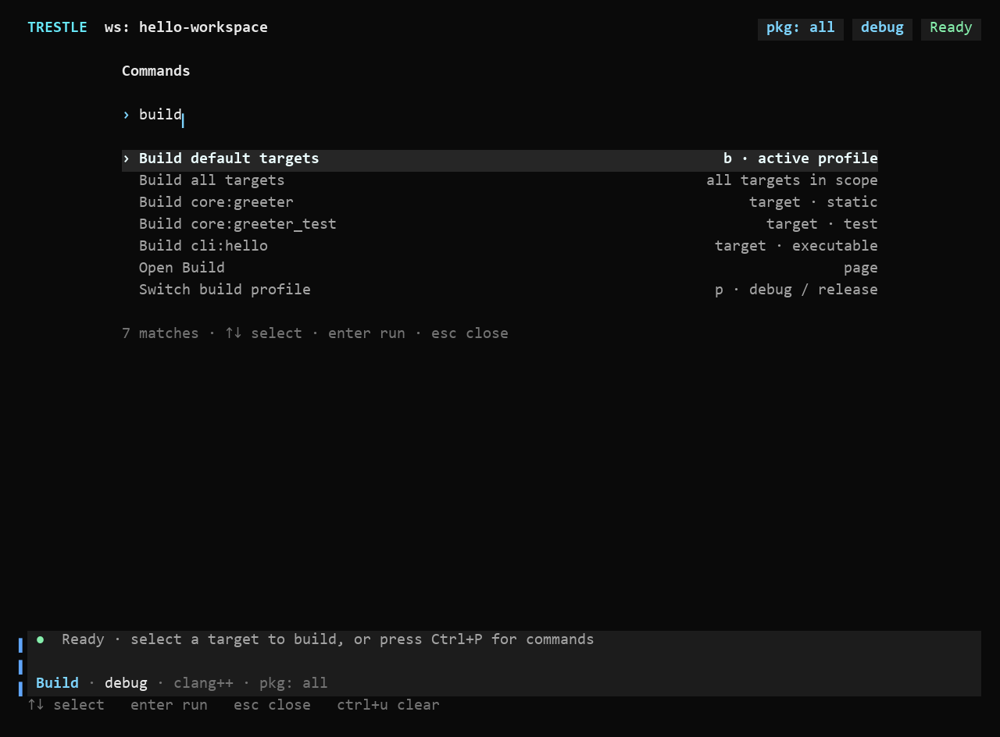

# TUI 工作台

在项目目录执行 `trestle`，或执行 `trestle tui -C <项目目录>` 打开工作台。

首页直接列出当前范围内的构建目标。用上下键选择目标，按 Enter 构建；按 `b` 构建配置中的默认目标。Workspace 根目录会列出各成员的目标，例如 `core:greeter` 和 `cli:hello`。

以上预览由实际 TUI 渲染器使用示例数据生成；字体和背景随终端设置变化。

## 命令面板

按 `Ctrl+P` 搜索操作、页面、目标、任务和 workspace 成员。输入名称后，用上下键选择、Enter 执行、Esc 关闭。支持英文缩写的模糊匹配和“构建”“测试”“依赖”等中文操作词。

例如：

- 输入 `settings` 打开设置，或输入 `toolchains` 打开工具链页面。
- 输入 `build app` 构建 app；在 workspace 根目录输入 `build cli:hello` 构建该成员的指定目标。
- 输入 `switch core` 切换到 core 成员，输入 `switch all` 返回全部成员。
- 输入任务名称，打开任务预览，再用 `y` 确认执行、`n` 取消。
- 输入 `history` 查看操作历史，输入 `output` 查看完整日志。

命令面板会搜索当前范围内的所有目标，不受目标列表筛选条件影响。已有操作运行时，仍可查看页面和输出；再次启动操作前需要取消当前操作。编辑输入或等待任务确认期间，键盘由该输入或确认提示处理。

## 常用快捷键

| 按键 | 操作 |
| --- | --- |
| `Ctrl+P` | 搜索命令、页面、目标、任务与成员 |
| `Ctrl+B` | 显示或隐藏导航侧栏 |
| `Tab` / `Shift+Tab` | 在可见面板间切换焦点 |
| `↑↓` / `j k` | 选择目标、导航项或日志行 |
| `Enter` | 执行当前选择；任务先预览 |
| `b` | 构建默认目标；Release 页面执行发布 |
| `/` | 首页和目标页筛选目标；设置页搜索设置；日志区搜索日志 |
| `a` | 首页和目标页构建全部目标；测试页运行全部测试 |
| `p` | 切换 debug / release |
| `F2` | 切换完整日志视图 |
| `F3` | 查看完整错误或所选项目详情，目标详情包含完整名称和源文件 |
| `F4` | 查看操作历史 |
| `F5` | 收起或展开日志区 |
| `End` | 在日志区恢复跟随最新输出 |
| `Esc` | 关闭当前弹层、取消输入或取消正在执行的操作 |
| `?` | 打开键盘参考 |
| `q` | 停止当前操作并退出 |

底部提示随当前页面和焦点变化。原有数字跳页仍可使用；在 workspace 导航中，数字对应当前成员下的页面编号。

## 布局和输入

默认隐藏侧栏，将宽度留给目标和输出。窄于 80 列时，导航使用整个主区域，Enter 打开页面，Esc 返回内容。

空日志区不占空间；开始构建、测试或安装后显示输出。少于 20 行的窗口按焦点显示内容或日志，可用 Tab 切换。`F2` 随时打开完整日志。

底部灰色区域固定显示状态或输入提示，以及当前构建配置、编译器和 workspace 成员范围。输入支持粘贴、`Ctrl+U` 清空、`Ctrl+W` 删除一个词。长输入会向左滚动，保留末尾和光标可见。

颜色随终端的深色或浅色背景切换。导航显示状态、页面选择和筛选条件仅在本次会话内保留。
